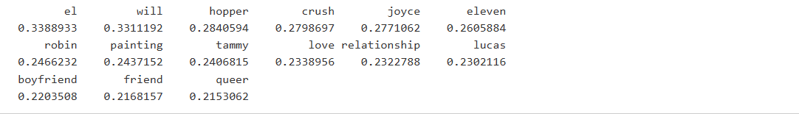
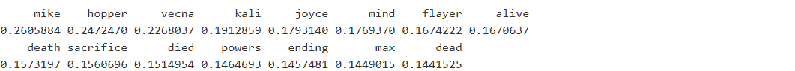
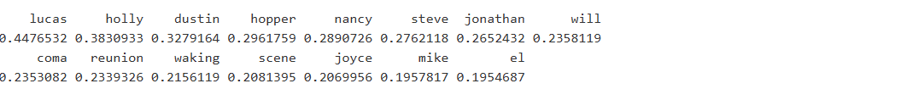
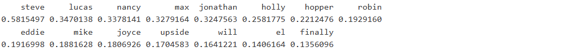
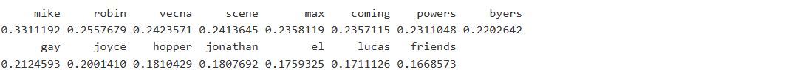
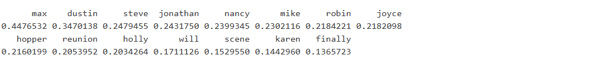

```{r setup, include=FALSE}
knitr::opts_chunk$set(echo = TRUE)
```

```{r library, include=FALSE}
#librerie utilizzate

library(stringr) # per manipolazione stringhe e funzioni pattern matching
library(readxl)  # lettura file excel
library(dplyr) # per manipolazione data frame
library(tidyr) # per manipolazione data frame
library(forcats) # per manipolazione fattori
library(ggplot2) # per visualizzazioni grafiche
library(reshape2) # per manipolazione dati
library(tm) # per text mining
library(tidytext) # per text mining
library(udpipe) # per POS tagging e RAKE
library(textclean) # per pulizia testi
library(topicmodels) # per topic modeling
library(ldatuning) # per topic modeling
library(quanteda) # per topic modeling


```

## Domanda di ricerca

Questo lavoro presenta un'analisi delle recensioni dell'ultima stagione di Stranger Things. L'obiettivo è utilizzare tecniche di text mining per estrarre informazioni utili, caratterizzare i personaggi principali della serie e analizzare il sentiment del pubblico nei loro confronti.

## Tipologia ed acquisizione dei dati

I dati sono stati acquisiti tramite web scraping dal sito IMDb, utilizzando Selenium. Il 19 gennaio 2026 sono state raccolte 7.937 recensioni in lingua inglese relative alla quinta e ultima stagione. Per ogni recensione, oltre al testo, sono state estratte le seguenti variabili:

-   Voto assegnato (scala 1-10).

-   Numero di "upvote" e "downvote".

-   Titolo della recensione.

-   Episodio di riferimento.

La distribuzione degli episodi è la seguente:

-   132 recensioni del primo episodio.

-   81 del secondo.

-   62 del terzo.

-   479 del quarto.

-   178 del quinto.

-   268 del sesto.

-   3176 del settimo.

-   3561 dell'ottavo.

Si è scelto di non raccogliere la data di pubblicazione della recensione, in quanto ritenuta poco rilevante per l'analisi poiché la stagione è stata conclusa il 1° gennaio 2026.

## Analisi preliminari

È stata condotta una prima pulizia del dataset, che ha incluso le seguenti operazioni:\

-   Conversione in formato numerico delle variabili rating, upvote e downvote.
-   Sostituzione dei valori mancanti (NA) nella variabile rating con la mediana del dataset, pari a 7.
-   Aggiunta di una variabile id univoca per ogni recensione.
-   Creazione di 20 variabili dicotomiche, una per ciascun personaggio principale della serie, con valore 1 in caso di citazione nella recensione e 0 altrimenti.\

```{r pulizia dataset, include=FALSE}
# Lettura del file con le recensioni (percorso relativo alla cartella docs/)
dta <- read_excel("../Data/stranger_things.xlsx")

dta[, 1] <- NULL # eliminiamo la prima colonna che contiene indice recensioni

# Aggiunge un id per ogni recensione
dta = dta %>% mutate(id = 1:n())
head(dta)

# puliamo le nostre variabili di contesto

# Conversione di rating in formato numerico
dta$rating <- as.numeric(dta$rating)
summary(dta$rating)

# 168 valori NA in rating: sostituiti con la mediana (valutazione pari a 7)

dta$rating[is.na(dta$rating)] <- median(dta$rating, na.rm = TRUE)
summary(dta$rating)

#controlliamo adesso upvote e downvote

table(dta$upvote)
# Presenti valori come 1k, 1.1K, 1.2K, 1.4K, 1.8K e 2.6K: convertiti in numerici

dta$upvote <- gsub("1K", "1000", dta$upvote)
dta$upvote <- gsub("1.1K", "1100", dta$upvote)
dta$upvote <- gsub("1.2K", "1200", dta$upvote)
dta$upvote <- gsub("1.4K", "1400", dta$upvote)
dta$upvote <- gsub("1.8K", "1800", dta$upvote)
dta$upvote <- gsub("2.6K", "2600", dta$upvote)

dta$upvote <- as.numeric(dta$upvote)

#facciamo la stessa cosa per i downvote

table(dta$downvote)
# Presenti valori come 1.4K, 1.5K: convertiti in numerici

dta$downvote <- gsub("1.4K", "1400", dta$downvote)
dta$downvote <- gsub("1.5K", "1500", dta$downvote)
dta$downvote <- as.numeric(dta$downvote)

# per ciascun personaggio principale creiamo una variabile dicotomica che indica se il 
# personaggio è menzionato nella recensione
dta$eleven <- ifelse(str_detect(tolower(dta$recensione), "eleven|Jane|\b el \b"), 1, 0)
dta$hopper <- ifelse(str_detect(tolower(dta$recensione), "hopper|jim"), 1, 0)
dta$joyce <- ifelse(str_detect(tolower(dta$recensione), "joyce"), 1, 0)
dta$will <- ifelse(str_detect((dta$recensione), "Will"), 1, 0) # soluzione più semplice per separare will come verbo da will protagonista
# visto che will come verbo è spesso minuscolo e l'anlisi del pos lavora peggio 
dta$max <- ifelse(str_detect(dta$recensione, "Max"), 1, 0) #si tiene maiuscolo anche con Max
dta$lucas <- ifelse(str_detect(tolower(dta$recensione), "lucas"), 1, 0)
dta$demogorgon <- ifelse(str_detect(tolower(dta$recensione), "demogorgon|demodog"), 1, 0)
dta$mike <- ifelse(str_detect(tolower(dta$recensione), "mike|michael"), 1, 0)
dta$dustin <- ifelse(str_detect(tolower(dta$recensione), "dustin|henderson"), 1, 0)
dta$nancy <- ifelse(str_detect(tolower(dta$recensione), "nancy"), 1, 0)
dta$steve <- ifelse(str_detect(tolower(dta$recensione), "steve|harrington"), 1, 0)
dta$jonathan <- ifelse(str_detect(tolower(dta$recensione), "jonathan"), 1, 0)
dta$billy <- ifelse(str_detect(tolower(dta$recensione), "billy|hargrove"), 1, 0)
dta$robin <- ifelse(str_detect(tolower(dta$recensione), "robin|buckley"), 1, 0)
dta$erica <- ifelse(str_detect(tolower(dta$recensione), "erica"), 1, 0)
dta$vecna <- ifelse(str_detect(tolower(dta$recensione), "vecna|henry"), 1, 0)
dta$eddie <- ifelse(str_detect(tolower(dta$recensione), "eddie|munson"), 1, 0)
dta$murray <- ifelse(str_detect(tolower(dta$recensione), "murray"), 1, 0)
dta$holly <- ifelse(str_detect(tolower(dta$recensione), "holly"), 1, 0)
dta$kali <- ifelse(str_detect(tolower(dta$recensione), "kali|eight"), 1, 0)

```

Al fine di ottenere una prima comprensione del corpus testuale e dei metadati raccolti, si è proceduto a un'analisi descrittiva dei dati.

```{r correlazione v.numeriche, echo=FALSE}
cor(dta[, c("rating", "upvote", "downvote", "episodio")])
```

Dall’esame delle relazioni tra le variabili numeriche emergono alcuni andamenti significativi:

-   Relazione tra valutazione ed engagement: Si osserva una correlazione negativa, seppur di modesta entità, tra il rating e le variabili upvote e downvote. Questo suggerisce che le recensioni con voti più bassi tendano a generare un maggior numero di interazioni, probabilmente perché suscitano maggiore discussione o polarizzazione di opinioni.
-   Correlazione tra upvote e downvote: La correlazione positiva riscontrata tra upvote e downvote indica che le recensioni più visibili o controverse tendono a raccogliere simultaneamente un alto numero di reazioni sia positive che negative, tipico dei contenuti che generano dibattito.\
-   Andamento del rating per episodio: La correlazione negativa tra rating e numero progressivo dell’episodio è principalmente spiegata dal fatto che gli episodi conclusivi (in particolare il 7 e l'8) hanno ricevuto valutazioni medie più basse, riflettendo pareri più contrastanti nel pubblico rispetto agli episodi iniziali.

### Frequenza di citazione dei personaggi

Successivamente, per identificare i personaggi più discussi, è stata analizzata la frequenza relativa delle citazioni di ciascuno dei 20 personaggi considerati all’interno del corpus testuale.

```{r freq personaggi, echo=FALSE}
character_cols <- names(dta)[8:27]

### 1.a Frequenze assolute e percentuali citazioni personaggi
#crea un tibble cha ha sulle colonne freq percentuale e assoluta per ciascun personaggio
character_stats <- dta %>%
  summarise(across(all_of(character_cols), list(
    count = ~sum(. == 1, na.rm = TRUE),
    perc = ~mean(. == 1, na.rm = TRUE) * 100
  )))

# Riorganizza in formato più leggibile ( da formto largo a lungo, colonne personaggi, f.ass e f.perc)
character_stats_long <- character_stats %>%
  pivot_longer(everything(), 
               names_to = c("character", ".value"), #specifica le nuove colonne da creare, 
               #.value crea colonne con nomi dopo character_
               names_pattern = "(.*)_(count|perc)") %>% #specifica di prendere count e perc
  arrange(desc(count))

# Visualizzazione

ggplot(character_stats_long, aes(x = reorder(character, -perc), y = perc)) + #reorder ordina per percentuale
  geom_bar(stat = "identity", fill = "steelblue") +
  labs(title = "Percentuale di recensioni che menzionano ogni personaggio",
       x = "Personaggio", y = "Percentuale (%)") +
  theme_minimal() +
  theme(axis.text.x = element_text(angle = 45, hjust = 1))
```

Dall'analisi della frequenza relativa delle citazioni emergono chiaramente i personaggi più centrali nel dibattito del pubblico riguardo all'ultima stagione.\
Personaggi più citati:

-   Will: È il personaggio più menzionato, il che ne sottolinea la rilevanza narrativa e il ruolo centrale e l'evoluzione nella quinta stagione.

-   Vecna: L'antagonista principale compare al secondo posto, a conferma del grande interesse per la sua caratterizzazione, in particolare per la rivelazione del suo passato e il suo ruolo nello scontro finale.

-   Mike ed Eleven: La coppia protagonista storica della serie si conferma tra i personaggi più discussi, indicando come la loro storia e il loro arco narrativo rimangano fondamentali per il pubblico anche nella stagione conclusiva.

Questa distribuzione delle menzioni fornisce una prima mappa tematica dell'attenzione del pubblico e guiderà le successive analisi di sentiment e RAKE per approfondire come e perché questi personaggi vengono discussi.

### Analisi delle menzioni dei personaggi per episodio

Per comprendere come l'attenzione del pubblico si sia distribuita nel corso della stagione, si procede ora ad analizzare la frequenza delle citazioni dei personaggi suddivisa per episodio.

```{r freq personaggi episodio, echo=FALSE}
# Menzioni per episodio (dataset largo, colonne episodio e personaggi, f.perc)
mentions_by_episode <- dta %>%
  group_by(episodio) %>%
  summarise(across(all_of(character_cols), ~mean(. == 1, na.rm = TRUE)*100))

# Converti in formato lungo per visualizzazione
mentions_long <- mentions_by_episode %>%
  pivot_longer(-episodio, names_to = "character", values_to = "mentions") # mantiene colonna episodio

# Heatmap delle menzioni
ggplot(mentions_long, aes(x = episodio, y = character, fill = mentions)) +
  geom_tile() +
  scale_fill_gradient(low = "white", high = "darkred") +
  labs(title = "Menzioni dei personaggi per episodio",
       x = "Episodio", y = "Personaggio") +
  theme_minimal()
```

L'analisi della frequenza delle citazioni per episodio rivela come i picchi di attenzione verso determinati personaggi siano direttamente correlati a svolte narrative chiave, confermando che le discussioni del pubblico sono profondamente guidate dalla trama. L'ispezione delle serie temporali episodiche per ciascun personaggio ha evidenziato le seguenti associazioni critiche:

-   Will: I picchi significativi nel quarto e nel settimo episodio coincidono, rispettivamente, con la rivelazione dei suoi poteri e con la scena del coming out, quest'ultima particolarmente dibattuta nella community. Ciò sottolinea come il suo arco personale sia stato uno dei fulcri tematici della stagione.
-   Nancy e Jonathan: Il picco congiunto delle loro menzioni nel sesto episodio è associabile alla conclusione definitiva della loro relazione sentimentale, un momento narrativo che ha catturato l'attenzione del pubblico.
-   Max: La sua massima frequenza di citazione nel sesto episodio corrisponde al momento di massima tensione in cui tenta di fuggire dalla dimensione mentale di Vecna.
-   Holly: Le sue menzioni si concentrano nel secondo episodio (il rapimento da parte dei Demogorgoni) e nel sesto, durante il tentativo di fuga con Max, evidenziando i momenti in cui il suo personaggio diventa centrale per la trama.\

Questi pattern confermano che l'analisi delle menzioni per episodio funziona come un efficace "termometro" dell'impatto narrativo degli eventi.

## Analisi co-occorrenze personaggi

È stata generata una matrice di co-occorrenza e la relativa heatmap (mappa di calore). Questa visualizzazione offre una prospettiva complementare e immediatamente leggibile della forza delle associazioni tra i personaggi all'interno del corpus delle recensioni.\
La matrice è stata costruita calcolando, per ogni coppia di personaggi, il numero di recensioni in cui essi compaiono entrambi. Per evitare che le co-occorrenze fossero dominate dalla frequenza individuale dei personaggi, la matrice è stata normalizzata calcolando l'Indice di Jaccard. Questo indice, che varia da 0 a 1, misura la proporzione di recensioni che menzionano entrambi i personaggi rispetto a quelle che ne menzionano almeno uno, offrendo così una misura pulita della forza dell'associazione relativa.

```{r co-occorrenze personaggi, echo=FALSE}
# Calcolo matrice di Jaccard (normalizzata)
jac_matrix <- matrix(0, nrow = length(character_cols), ncol = length(character_cols))
rownames(jac_matrix) <- character_cols
colnames(jac_matrix) <- character_cols

for (i in 1:length(character_cols)) {
  for (j in 1:length(character_cols)) {
    if (i != j) {
      # Intersezione: co-occorrenza
      intersection <- sum(dta[[character_cols[i]]] == 1 & dta[[character_cols[j]]] == 1, na.rm = TRUE)
      # Unione: almeno uno dei due presente
      union_count <- sum(dta[[character_cols[i]]] == 1 | dta[[character_cols[j]]] == 1, na.rm = TRUE)
      # Indice di Jaccard
      jac_matrix[i, j] <- ifelse(union_count > 0, intersection / union_count, 0)
    }
  }
}

# Imposta la diagonale a NA per migliore visualizzazione
diag(jac_matrix) <- NA

# Trasforma in formato lungo per ggplot
jac_melted <- melt(jac_matrix)

# Heatmap normalizzata
ggplot(jac_melted, aes(x = Var1, y = Var2, fill = value)) +
  geom_tile(color = "white") +
  scale_fill_gradient2(
    low = "blue", 
    mid = "white", 
    high = "red",
    midpoint = median(jac_melted$value, na.rm = TRUE),
    na.value = "grey90",
    name = "Indice di Jaccard"
  ) +
  labs(
    title = "Associazioni tra personaggi (Indice di Jaccard)",
    subtitle = "Valori più alti indicano una più forte associazione relativa",
    x = NULL, y = NULL
  ) +
  theme_minimal() +
  theme(
    axis.text.x = element_text(angle = 45, hjust = 1, face = "bold"),
    axis.text.y = element_text(face = "bold"),
    legend.position = "right"
  ) +
  coord_fixed()  # Mantiene le celle quadrate
```

Per quanto i valori non siano elevatissimi notiamo due cluster interessanti:

-   Hopper-Joyce: Rappresenta il nucleo familiare/alleanza adulta più solida. La loro associazione riflette la percezione del pubblico come unità narrativa coesa.

-   Dustin-Nancy-Steve-Jonathan: Evidenzia la rete relazionale complessa tra questi personaggi. Nancy e Jonathan come coppia, Steve come ex e amico, e Dustin come elemento collante del gruppo.

### Impatto delle Citazioni dei Personaggi sul Rating

Per valutare se la menzione di specifici personaggi sia associata a un gradimento più alto o più basso della stagione, è stata condotta un'analisi comparativa dei rating.

\
Per ciascuno dei 20 personaggi, il dataset è stato suddiviso in due gruppi:

Recensioni che citano il personaggio (menzione = 1).

Recensioni che non citano il personaggio (menzione = 0).

Per ogni gruppo è stato calcolato il rating medio. La differenza tra queste due medie indica l'impatto associativo del personaggio sul voto. Un delta positivo suggerisce che le recensioni che lo nominano tendono a dare voti più alti; un delta negativo suggerisce il contrario.

```{r rating personaggi, echo=FALSE}
# Calcola le differenze per ogni personaggio
rating_diffs <- dta %>%
  summarise(across(all_of(character_cols), 
                   ~ mean(rating[.x == 1], na.rm = TRUE) - mean(rating[.x == 0], na.rm = TRUE))) %>%
  pivot_longer(everything(), names_to = "character", values_to = "diff")

# Aggiungi il numero di citazioni per ogni personaggio (per dimensione dei punti)
citation_counts <- dta %>%
  summarise(across(all_of(character_cols), ~ sum(.x == 1, na.rm = TRUE))) %>%
  pivot_longer(everything(), names_to = "character", values_to = "n_citations")

rating_diffs <- rating_diffs %>%
  left_join(citation_counts, by = "character") %>%
  mutate(sign = ifelse(diff > 0, "Positivo", "Negativo"))

# Ordina i personaggi per differenza
rating_diffs <- rating_diffs %>%
  mutate(character = fct_reorder(character, diff))

# Crea il grafico
ggplot(rating_diffs, aes(x = diff, y = character, fill = sign)) +
  geom_col() +
  geom_vline(xintercept = 0, linetype = "dashed", color = "gray40") +
  geom_point(aes(size = n_citations), shape = 21, color = "black", show.legend = TRUE) +
  scale_fill_manual(values = c("Positivo" = "#2E8B57", "Negativo" = "#DC143C")) +
  scale_size_continuous(range = c(2, 8), 
                        breaks = c(100, 500, 1000, 2000, 3000),
                        name = "Numero di citazioni") +
  labs(
    title = "Impatto delle citazioni sul rating della stagione",
    subtitle = "Differenza nel rating medio tra recensioni con e senza menzione del personaggio",
    x = "Differenza nel rating medio\n(Citato - Non citato)",
    y = "",
    fill = "Impatto"
  ) +
  theme_minimal() +
  theme(
    legend.position = "right",
    panel.grid.major.y = element_blank(),
    axis.text.y = element_text(size = 10, face = "bold")
  ) +
  scale_x_continuous(breaks = seq(-2, 2, by = 0.5))

```

L'analisi delle differenze nel rating medio rivela che la menzione di alcuni personaggi è associata a variazioni importanti nel gradimento.\
Associazione positiva: La citazione di personaggi come Dustin, Lucas, Steve, Eddie e Holly è associata a rating medi più elevati. Ciò suggerisce che i loro archi narrativi, il loro sviluppo o le loro scene nella stagione finale siano stati particolarmente apprezzati dal pubblico, fungendo da elementi di soddisfazione.\
Associazione negativa: Al contrario, le recensioni che menzionano i Demogorgon, Mike, Hopper e Vecna tendono a presentare rating medi più bassi. Questo dato può indicare una certa insoddisfazione o polarizzazione del pubblico riguardo alle storyline che li coinvolgono, al loro sviluppo in questa stagione o, nel caso degli antagonisti, a una percezione negativa legata al tono delle loro scene.\

### Caratterizzazione Lessicale dei Personaggi tramite Correlazione Testuale

Per ottenere una prima caratterizzazione semantica dei protagonisti, è stata condotta un'analisi delle parole più fortemente correlate alla menzione dei personaggi principali nel corpus delle recensioni.\
Il testo delle recensioni è stato sottoposto a un processo di pulizia e normalizzazione:

-   Tokenizzazione: Suddivisione del testo in unità lessicali (parole).

-   Normalizzazione: Tutti i token sono stati convertiti in minuscolo.

-   Pulizia: Rimozione di punteggiatura, caratteri numerici e stop word. È stata utilizzata la stop list "smart", dalla quale è stato espressamente escluso il termine "will" per evitare di rimuovere il nome del personaggio Will Byers.

-   Costruzione della Matrice: Dai testi processati è stata costruita una document-term matrix (DTM), una matrice a frequenze che rappresenta il conteggio di ciascun termine in ciascun documento (recensione).

Per individuare le associazioni lessicali più significative, si è scelto di calcolare la correlazione tra la presenza di un termine nella DTM e la variabile dicotomica che indica la menzione di un personaggio. Dato che la distribuzione dei termini nella DTM non segue una distribuzione normale (è tipicamente sparsa e asimmetrica), è stato utilizzato il coefficiente di correlazione per ranghi di Spearman, una misura non parametrica più robusta in questo contesto.\
La funzione standard findAssocs del pacchetto tm (in R) è stata modificata per implementare il calcolo della correlazione di Spearman tra ciascun termine lessicale e la variabile di ciascun personaggio.

```{r correlazioni, include=FALSE}
stoplist <- get_stopwords(language = "en", source = "smart") 
stoplist <- stoplist %>% filter(word != "will")

# Preprocessing testi: tokenizzazione, rimozione stopwords, rimozione numeri e punteggiatura

# Unigrammi o parole senza stopwords, numeri e punteggiatura

#prendiamo singoli token puliti ed eliminaando stop word
tt_ww <- dta %>% 
  select(recensione,id, eleven,max, will, lucas, dustin, mike) %>% 
  unnest_tokens(word, recensione, to_lower=FALSE) %>%
  filter(word != "will") %>% 
  mutate(word=tolower(word)) %>%
  filter(!str_detect(word, "^[0-9]+$")) %>% #togli numeri
  filter(!str_detect(word, "[[:punct:]]+")) %>%#togli punteggiatura 
  anti_join(stoplist, by = "word")
##### analisi associazioni ######

### funzione per effettuare findAssocs con correlazione di Spearman
findAssocs.DocumentTermMatrix_sp <- function(x, terms, corlimit) {
  if (length(terms) != 1L) 
    stop("'terms' must be a single term")
  
  i <- match(terms, colnames(x))
  if (is.na(i)) 
    stop("'terms' not found")
  
  # Transpose to treat as term-document matrix
  m <- as.matrix(t(x))
  cor_m <- cor(t(m), method="spearman")
  
  # Extract correlations for the specific term
  cors <- cor_m[, i]
  
  # Filter by correlation limit and remove self-correlation
  cors <- cors[cors >= corlimit]
  cors <- cors[names(cors) != terms]
  
  # Sort in descending order
  sort(cors, decreasing = TRUE)
}

# calcoliamo le frequenze di ogni parola per documento 
tt_ww = tt_ww %>% group_by(id,word) %>% mutate(freq = n()) %>% unique()


dtm <- tt_ww %>% cast_dtm(document = id,term = word,value = freq)

```

Dall'analisi delle parole maggiormente correlate (coefficiente di Spearman) alla menzione di ciascun personaggio emergono profili lessicali distinti che riflettono i loro ruoli narrativi, le relazioni chiave e gli eventi che li hanno caratterizzati nella stagione finale.

**Mike**

```{r associazioni mike, eval=FALSE, include=FALSE}
ass_mike <- findAssocs.DocumentTermMatrix_sp(dtm, "mike", 0.1)
head(ass_mike, n=15)
```



Il suo profilo è dominato dalle relazioni interpersonali

-   Eleven, boyfriend, crush: Confermano la centralità della sua relazione sentimentale con Eleven.

-   Will, queer: Rivelano il legame con Will e fanno riferimento alla delicata dinamica dei sentimenti non corrisposti di Will nei suoi confronti, culminata nel coming out.

**Eleven**

```{r associazioni el, eval=FALSE, include=FALSE}
ass_el <- findAssocs.DocumentTermMatrix_sp(dtm, "eleven", 0.1)
head(ass_el, n=15)
```



Le associazioni delineano il suo ruolo di protagonista e le relazioni che definiscono la sua identità:

-   Mike, Hopper: Evidenziano il suo nucleo affettivo.

-   Kali: Richiama il passato condiviso nel laboratorio e il ruolo cruciale di Kali nel suo sacrificio finale, spiegando anche le forti correlazioni con death e sacrifice.

-   Vecna, Mind Flayer: Sottolineano la sua funzione eroica di principale antagonista delle forze del Sottosopra, con una correlazione particolarmente elevata per Vecna, avversario diretto della stagione.

**Max**

```{r associazioni max, eval=FALSE, include=FALSE}
ass_max <- findAssocs.DocumentTermMatrix_sp(dtm, "Max", 0.1)
head(ass_max, n=15)
```



Le parole associate raccontano una storia di pericolo, resilienza e connessione:

-   Lucas e reunion: Indicano il ricongiungimento con il ragazzo di cui è innamorata, momento emotivo cardine.

-   Holly: La compagna di prigionia nella dimensione di Vecna.

-   coma e waking: Descrivono in modo diretto il suo arco narrativo principale: cadere in coma per colpa di Vecna e il risveglio salvifico.

**Dustin**

```{r associazioni dustin, eval=FALSE, include=FALSE}
ass_dustin <- findAssocs.DocumentTermMatrix_sp(dtm, "dustin", 0.1)
head(ass_dustin, n=15)
```



Il suo lessico correlato evidenzia i legami di amicizia più forti e la lealtà:

-   Steve: Riflette il loro rapporto di fratellanza atipica e molto amata dal pubblico.

-   Eddie: Parla della lealtà e del lutto per l'amico eroicamente scomparso nella stagione precedente, un trauma ancora presente.

**Will**

```{r associazioni will, eval=FALSE, include=FALSE}
ass_will <- findAssocs.DocumentTermMatrix_sp(dtm, "Will", 0.1)
head(ass_will, n=15)
```



Le associazioni mappano il suo complesso viaggio emotivo e narrativo:

-   Mike: Oggetto dei suoi sentimenti e fulcro della sua crisi personale.

-   Robin: Figura catalizzatrice che, con la sua saggezza e apertura, lo aiuta ad accettarsi.

-   Vecna: Il nemico che lo ha manipolato e contro cui deve combattere per l'ultima volta.

-   Gay, coming: Termini che certificano quantitativamente l'impatto della scena del coming out nell'episodio 7, identificandola come il momento più discusso e caratterizzante del suo personaggio.

**Lucas**

```{r associazioni lucas, eval=FALSE, include=FALSE}
ass_lucas <- findAssocs.DocumentTermMatrix_sp(dtm, "lucas", 0.1)
head(ass_lucas, n=15)
```



Il suo profilo è incentrato sull'azione e sul rapporto salvifico con Max:

-   Max, reunion: Confermano il ruolo della sua relazione come motore emotivo.

-   Karen: Probabilmente riferito a Karen Wheeler, la cui azione eroica nel sesto episodio contribuisce direttamente a salvare lui e altri personaggi.\

## Analisi indice RAKE

Per approfondire la caratterizzazione lessicale dei personaggi principali andando oltre le semplici correlazioni, è stata implementata una tecnica di estrazione automatica di parole chiave utilizzando l'algoritmo RAKE (Rapid Automatic Keyword Extraction).

### Metodologia e implementazione

L'implementazione è stata realizzata in R tramite la libreria udpipe. L'algoritmo RAKE identifica le parole chiave analizzando la frequenza delle parole e la loro co-occorrenza all'interno di "unità contestuali" definite, calcolando un punteggio basato sul grado e sulla frequenza di ciascun termine.\
Inizialmente, l'unità contestuale è stata definita come l'intero testo di una recensione. Per ogni personaggio, RAKE è stato applicato al corpus costituito da tutte le recensioni in cui il personaggio era citato. L'output presentava un rumore significativo, con molte parole generiche o legate alla serie in generale piuttosto che caratterizzanti del personaggio specifico. Ciò era dovuto all'ampiezza del contesto, che diluiva i segnali lessicali specifici.\
Per ovviare a questo problema, la strategia è stata modificata utilizzando come contesto degli n-grammi di lunghezza 6 (sequenze di 6 parole) estratti dal corpus. L'ipotesi era che limitando il contesto a finestre testuali più piccole e potenzialmente più coese, si sarebbero catturati modelli lessicali più specifici e caratterizzanti del ruolo narrativo o delle azioni del personaggio.

### Logica del Refinement

Il passaggio dagli interi documenti (recensioni) agli n-grammi come unità di analisi si basa:

Contesto Ampio (Documento): Favorisce l'emersione di temi generali e condivide molto rumore tra personaggi che compaiono nelle stesse discussioni d'insieme.

Contesto Ristretto (N-gramma): Isola meglio le frasi o le espressioni tipiche in cui un personaggio viene menzionato, aumentando la probabilità di catturare attributi, azioni o contesti narrativi a lui unicamente associati.

Questa modifica metodologica ha permesso di filtrare il rumore e ottenere un elenco di keyword più precise e interpretabili per ciascun personaggio, facilitando la successiva fase di analisi qualitativa e caratterizzazione.

I token sono stati analizzati sintatticamente per conservare soltanto sostantivi (nomi) e aggettivi. Questa scelta è motivata dal fatto che queste categorie lessicali sono portatrici naturali del contenuto tematico e degli attributi descrittivi (es., "sacrificio", "coraggioso", "traumatico"), a differenza di verbi o avverbi che più spesso denotano azioni generiche o relazioni grammaticali.

L'analisi si è concentrata sugli unigrammi piuttosto che su n-grammi più lunghi. Questo ha permesso di identificare i concetti atomici e gli attributi fondamentali associati a ciascun personaggio, evitando la frammentazione eccessiva del segnale in frasi idiomatiche rare o combinazioni lessicali non ricorrenti.

La sezione successiva presenterà i risultati di questa analisi, mostrando per i personaggi principali le parole chiave più indicative emerse dall'applicazione di RAKE sul contesto degli n-grammi e la loro interpretazione narrativa.

```{r, include=FALSE}
# Annotazione del corpus di recensioni con udpipe:
# si carica il modello linguistico incluso nella repository (cartella Data/)
model <- udpipe_load_model("../Data/english-ewt-ud-2.5-191206.udpipe")
```

```{r rake per recensione, eval=FALSE, include=FALSE}

#controlliamo in dta le recensioni in cui compare uno solo dei personaggi principali

dta_r = dta %>%
  select(recensione, id, eleven, max, will, lucas, dustin, mike)

# crea nuova colonna personaggi che ha valore numerico dipendentemente dal personaggio citato ed elimina
# le vecchie colonne dei personaggi

##### mike ######

mike_dta <- dta_r %>% filter(mike==1)

# annotiamo i testi
annotated_carachter_mike <- udpipe_annotate(model, x = mike_dta$recensione)
annotated_carachter_mike <- as.data.frame(annotated_carachter_mike)

# applichiamo algoritmo RAKE 
keywords_mike <- keywords_rake(
  x = annotated_carachter_mike ,
  term = "token",
  group = "doc_id", 
  relevant = annotated_carachter_mike$upos %in% c("NOUN", "ADJ"), 
  ngram_max = 1
)

# ordiniamo per RAKE score
keywords_mike <- keywords_mike %>% arrange(desc(rake))
head(keywords_mike, 30)

##### eleven ######
eleven_dta <- dta_r %>% filter(eleven==1)
# annotiamo i testi
annotated_carachter_eleven <- udpipe_annotate(model, x = eleven_dta$recensione)
annotated_carachter_eleven <- as.data.frame(annotated_carachter_eleven)
#applichiamo algoritmo
keywords_eleven <- keywords_rake(
  x = annotated_carachter_eleven , 
  term="token", 
  group="doc_id",
  relevant = annotated_carachter_eleven$upos %in% c("NOUN", "ADJ"), 
  ngram_max = 1
)

##### dustin ######
dustin_dta <- dta_r %>% filter(dustin==1)
# annotiamo i testi
annotated_carachter_dustin <- udpipe_annotate(model, x = dustin_dta$recensione)
annotated_carachter_dustin <- as.data.frame(annotated_carachter_dustin)
#applichiamo algoritmo
keywords_dustin <- keywords_rake(
  x = annotated_carachter_dustin , 
  term="token", 
  group="doc_id",
  relevant = annotated_carachter_dustin$upos %in% c("NOUN", "ADJ"), 
  ngram_max = 1
)

##### lucas ######
lucas_dta <- dta_r%>% filter(lucas==1)
# annotiamo i testi
annotated_carachter_lucas <- udpipe_annotate(model, x = lucas_dta$recensione)
annotated_carachter_lucas <- as.data.frame(annotated_carachter_lucas)
# applichiamo algoritmo
keywords_lucas <- keywords_rake(
  x = annotated_carachter_lucas , 
  term="token", 
  group="doc_id",
  relevant = annotated_carachter_lucas$upos %in% c("NOUN", "ADJ"), 
  ngram_max = 1
)

##### max ######
max_dta <- dta_r %>% filter(max==1)
# annotiamo i testi
annotated_carachter_max <- udpipe_annotate(model, x = max_dta$recensione)
annotated_carachter_max <- as.data.frame(annotated_carachter_max)
# applichiamo algoritmo
keywords_max <- keywords_rake(
  x = annotated_carachter_max , 
  term="token", 
  group="doc_id",
  relevant = annotated_carachter_max$upos %in% c("NOUN", "ADJ"), 
  ngram_max = 1
)

##### will ######
will_dta <- dta_r %>% filter(will==1)
# annotiamo i testi
annotated_carachter_will <- udpipe_annotate(model, x = will_dta$recensione)
annotated_carachter_will <- as.data.frame(annotated_carachter_will)
#applichiamo algoritmo
keywords_will <- keywords_rake(
  x = annotated_carachter_will , 
  term="token", 
  group="doc_id",
  relevant = annotated_carachter_will$upos %in% c("NOUN", "ADJ"), 
  ngram_max = 1
)


# View top keywords
head(keywords_will, 20)
head(keywords_mike, 20)
head(keywords_dustin, 20)
head(keywords_lucas, 20)
head(keywords_eleven, 20)
head(keywords_max, 20)
```

```{r rake per n-gram, include=FALSE}
# proviamo a fare rake utilizzando come unità di testo la frase e non la recensione, dato che
# sembra esserci parecchio rumore utilizzando la recensione

sen_dta <-dta %>%
  select(id, recensione) %>%
  unnest_tokens(
    output = frase, 
    input = recensione, 
    token = "ngrams", 
    n= 6, 
    to_lower = FALSE,    # mantieni maiuscole per nomi propri
    drop = FALSE        # mantieni colonna originale
  ) %>%
  mutate(
    frase_id = paste0(id, "_", row_number()) #id unico per frase
  )

sen_dta$eleven <- ifelse(str_detect(tolower(sen_dta$frase), "eleven|Jane|\b el \b"), 1, 0)
sen_dta$will <- ifelse(str_detect((sen_dta$frase), "Will"), 1, 0) # soluzione più semplice per separare will come verbo da will protagonista
# visto che will come verbo è spesso minuscolo e l'anlisi del pos lavora peggio 
sen_dta$max <- ifelse(str_detect(sen_dta$frase, "Max"), 1, 0) #si tiene maiuscolo anche con Max
sen_dta$lucas <- ifelse(str_detect(tolower(sen_dta$frase), "lucas"), 1, 0)
sen_dta$mike <- ifelse(str_detect(tolower(sen_dta$frase), "mike|michael"), 1, 0)
sen_dta$dustin <- ifelse(str_detect(tolower(sen_dta$frase), "dustin|henderson"), 1, 0)

#controlliamo in dta le recensioni in cui compare uno solo dei personaggi principali

sen_dta = sen_dta %>%
  select(frase_id, frase, eleven, max, will, lucas, dustin, mike)

# crea nuova colonna personaggi che ha valore numerico dipendentemente dal personaggio citato ed elimina
# le vecchie colonne dei personaggi

```

**Mike**

```{r mike RAKE, echo=FALSE}

mike_dta_s <- sen_dta %>% filter(mike==1)

# annotiamo i testi
annotated_carachter_mike_s <- udpipe_annotate(model, x = mike_dta_s$frase)
annotated_carachter_mike_s <- as.data.frame(annotated_carachter_mike_s)

# applichiamo algoritmo RAKE 
keywords_mike_s <- keywords_rake(
  x = annotated_carachter_mike_s ,
  term = "token",
  group = "doc_id", 
  relevant = annotated_carachter_mike_s$upos %in% c("NOUN", "ADJ"),
  ngram_max = 1
)

# ordiniamo per RAKE score
keywords_mike_s <- keywords_mike_s %>% arrange(desc(rake))
head(keywords_mike_s, 10)
```

Per Mike, tra le parole chiave più rilevanti e interpretabili troviamo:

-   bench: Fa diretto riferimento alla scena conclusiva dell'ultimo episodio, in cui Mike è seduto su una panchina. Questo termine coglie un'immagine potente e statica che rappresenta probabilmente un momento di riflessione, passaggio o attesa, diventando un'ancora lessicale per il pubblico nella discussione della sua chiusura narrativa.

-   dungeon master: Questa keyword identifica con precisione il ruolo che Mike assume nell'ultima scena della serie, durante la partita a Dungeons & Dragons con il gruppo. Oltre a essere un chiaro richiamo intertestuale all'inizio della serie, questo termine segna il suo ritorno a una funzione centrale di guida e narratore all'interno del gruppo, chiudendo il cerchio della sua crescita personale.

**Eleven**

```{r el RAKE, echo=FALSE}

eleven_dta_s <- sen_dta %>% filter(eleven==1)

# annotiamo i testi
annotated_carachter_eleven_s <- udpipe_annotate(model, x = eleven_dta_s$frase)
annotated_carachter_eleven_s <- as.data.frame(annotated_carachter_eleven_s)

# applichiamo algoritmo RAKE 
keywords_eleven_s <- keywords_rake(
  x = annotated_carachter_eleven_s ,
  term = "token",
  group = "doc_id", 
  relevant = annotated_carachter_eleven_s$upos %in% c("NOUN", "ADJ"), 
  ngram_max = 1
)

# ordiniamo per RAKE score
keywords_eleven_s <- keywords_eleven_s %>% arrange(desc(rake))
head(keywords_eleven_s, 10)
```

Per Eleven tra le parole chiave più rilevanti e interpretabili troviamo:

-   death: Questo termine identifica il culmine eroico e potenzialmente tragico del suo percorso. È il lessema che il pubblico associa all'epilogo della sua battaglia contro Vecna, riflettendo la possibilità (o la realtà) del suo sacrificio definitivo per salvare gli altri, un sacrificio che contraddistingue il personaggio di Eleven.

-   happy, back: Queste parole catturano l'ipotesi opposta e il desiderio del pubblico. Fa riferimento alla speranza – sollevata in particolare da Mike – di un ritorno a una vita normale e felice per Eleven, qualora fosse sopravvissuta. È la keyword che rappresenta la ricerca di una conclusione redentiva e pacifica per il suo tormentato viaggio.

**Max**

```{r max RAKE, echo=FALSE}
max_dta_s <- sen_dta %>% filter(max==1)

# annotiamo i testi
annotated_carachter_max_s <- udpipe_annotate(model, x = max_dta_s$frase)
annotated_carachter_max_s <- as.data.frame(annotated_carachter_max_s)

# applichiamo algoritmo RAKE 
keywords_max_s <- keywords_rake(
  x = annotated_carachter_max_s ,
  term = "token",
  group = "doc_id", 
  relevant = annotated_carachter_max_s$upos %in% c("NOUN", "ADJ"), 
  ngram_max = 1
)

# ordiniamo per RAKE score
keywords_max_s <- keywords_max_s %>% arrange(desc(rake))
head(keywords_max_s, 10)
```

Per Max tra le parole chiave più rilevanti e interpretabili troviamo:

-   armor: Questo termine è un probabile riferimento al concetto meta-narrativo di "plot armor", spesso usato nelle discussioni dei fan per descrivere la protezione narrativa di cui godono i personaggi principali. La sua presenza come parola chiave suggerisce che la sopravvivenza o le sorti di Max siano state un punto di dibattito consapevole nel pubblico, sollevando questioni sulla credibilità narrativa o sul realismo del suo arco di salvezza.

-   kiss: Fa diretto riferimento alla scena emotivamente carica in cui Max, dopo essersi risvegliata dal coma, condivide un bacio con Lucas nell'ascensore. Questo momento segna non solo il suo ritorno alla vita, ma anche la riaffermazione del suo legame affettivo con Lucas, diventando un simbolo potente di speranza e rinascita nel contesto della sua esperienza traumatica.

**Dustin**

```{r dustin RAKE, echo=FALSE}

dustin_dta_s <- sen_dta %>% filter(dustin==1)

# annotiamo i testi
annotated_carachter_dustin_s <- udpipe_annotate(model, x = dustin_dta_s$frase)
annotated_carachter_dustin_s <- as.data.frame(annotated_carachter_dustin_s)

# applichiamo algoritmo RAKE 
keywords_dustin_s <- keywords_rake(
  x = annotated_carachter_dustin_s ,
  term = "token",
  group = "doc_id", 
  relevant = annotated_carachter_dustin_s$upos %in% c("NOUN", "ADJ"), 
  ngram_max = 1
)

# ordiniamo per RAKE score
keywords_dustin_s <- keywords_dustin_s %>% arrange(desc(rake))
head(keywords_dustin_s, 10)
```

Per Dustin tra le parole chiave più rilevanti e interpretabili troviamo:

-   armour: Analogamente a quanto osservato per Max, questo termine è un probabile riferimento al concetto di "plot armor". La sua presenza suggerisce che la sopravvivenza e l'importanza narrativa di Dustin siano state riconosciute (o eventualmente criticate) come particolarmente protette, data la sua centralità nel gruppo e il suo status di personaggio amato sin dalle prime stagioni.

-   nancy: La presenza di Nancy come parola chiave specifica per Dustin indica una forte associazione contestuale tra i due personaggi nella stagione. Questo potrebbe riferirsi a scene condivise significative, come collaborazioni investigative o momenti di confronto che hanno lasciato un'impronta nel discorso del pubblico.

-   final, scenes, thanks: Questo insieme lessicale si riferisce alla scena conclusiva della serie, in cui Dustin (insieme agli altri) partecipa alla cerimonia del diploma. "Thanks" potrebbe catturare specificamente i ringraziamenti o il discorso di commiato del personaggio, un momento di gratitudine e chiusura emotiva che ha segnato la fine del suo viaggio.

**Will**

```{r will RAKE, echo=FALSE}
will_dta_s <- sen_dta %>% filter(will==1)

# annotiamo i testi
annotated_carachter_will_s <- udpipe_annotate(model, x = will_dta_s$frase)
annotated_carachter_will_s <- as.data.frame(annotated_carachter_will_s)

# applichiamo algoritmo RAKE 
keywords_will_s <- keywords_rake(
  x = annotated_carachter_will_s ,
  term = "token",
  group = "doc_id", 
  relevant = annotated_carachter_will_s$upos %in% c("NOUN", "ADJ"), 
  ngram_max = 1
)

# ordiniamo per RAKE score
keywords_will_s <- keywords_will_s %>% arrange(desc(rake))
head(keywords_will_s, 10)

```

Per Will tra le parole chiave più rilevanti e interpretabili troviamo:

-   middle: Potrebbe simboleggiare la sua posizione di transizione – bloccato tra il mondo normale e quello soprannaturale, o nel mezzo delle dinamiche del gruppo (specialmente tra Mike ed Eleven). È la parola chiave della sua sospensione emotiva.

-   choices: È il termine che definisce il cuore drammaturgico della sua stagione. Incarna il suo difficile percorso verso l'autenticità, culminato nella scelta di fare coming out e di dichiarare i suoi sentimenti, accettando le conseguenze che ne derivano.

**Lucas**

```{r lucas RAKE, echo=FALSE}
lucas_dta_s <- sen_dta %>% filter(lucas==1)

# annotiamo i testi
annotated_carachter_lucas_s <- udpipe_annotate(model, x = lucas_dta_s$frase)
annotated_carachter_lucas_s <- as.data.frame(annotated_carachter_lucas_s)

# applichiamo algoritmo RAKE 
keywords_lucas_s <- keywords_rake(
  x = annotated_carachter_lucas_s ,
  term = "token",
  group = "doc_id", 
  relevant = annotated_carachter_lucas_s$upos %in% c("NOUN", "ADJ"), 
  ngram_max = 1
)

# ordiniamo per RAKE score
keywords_lucas_s <- keywords_lucas_s %>% arrange(desc(rake))
head(keywords_lucas_s, 10)
```

Per Lucas tra le parole chiave più rilevanti e interpretabili troviamo:

-   Max: Conferma in modo diretto che la relazione con Max costituisce il centro narrativo della sua stagione. La sua storia è percepita e discussa dal pubblico principalmente in funzione di questo legame.

-   elevator: Fa riferimento alla scena iconica e carica di emotività in cui Max, appena risvegliatasi, condivide un momento di intimità con Lucas all'interno di un ascensore. Questa parola chiave fissa nella discussione il setting preciso di un momento di svolta, di riconnessione e vulnerabilità.

-   close e personal: Questi termini astratti descrivono la qualità della sua narrazione. Segnalano un passaggio da un ruolo all'interno del gruppo a una dimensione più intima e privata. La sua lotta diventa "personale" (salvare la persona che ama) e le sue interazioni sono caratterizzate da una vicinanza ("close") emotiva e fisica, specialmente nei confronti di Max.\

```{r topic modeling, eval=FALSE, include=FALSE}
# 1. Preprocess text

dfm <- dta$recensione %>%
  tokens(remove_punct = TRUE, remove_numbers = TRUE, remove_symbols = TRUE) %>%
  tokens_tolower() %>%
  tokens_remove(stopwords("en")) %>%
  tokens_wordstem() %>%  # or lemmatize
  tokens_ngrams(n = 1:2) %>%  # optional: include bigrams
  dfm()

# 2. Trim sparse terms
dfm <- dfm_trim(dfm, min_docfreq = 2, docfreq_type = "count")

# 3. Convert to topicmodels format
dtm <- convert(dfm, to = "topicmodels")

# 4. Find optimal topics
result <- FindTopicsNumber(
  dtm,
  topics = seq(4, 20, by = 2),
  metrics = c("CaoJuan2009", "Griffiths2004"),
  mc.cores = 1L,
  verbose = TRUE
)

# 5. Fit LDA with optimal topics
optimal_k <- result$topics[which.min(result$CaoJuan2009)]
lda_model <- LDA(dtm, k = optimal_k, method = "Gibbs", control = list(seed = 1234))

# Mostra le probabilità delle parole nei topic
char_topics <- tidy(lda_model, matrix = "beta")

# Mostra le parole più frequenti per ciascun topic
char_top_terms <- char_topics %>%
  group_by(topic) %>%
  slice_max(beta, n = 10) %>%
  ungroup() %>%
  arrange(topic, -beta)

# Crea un grafico a barre delle parole più frequenti per ciascun topic
char_top_terms %>%
  mutate(term = reorder_within(term, beta, topic)) %>%
  ggplot(aes(beta, term, fill = factor(topic))) +
  geom_col(show.legend = FALSE) +
  facet_wrap(~ topic, scales = "free") +
  scale_y_reordered()
```

## Sentiment analysis

L'obiettivo è valutare se la valenza emotiva (positiva, negativa) di una recensione cambia quando viene menzionato un personaggio specifico. Questo fornisce un'indicazione complementare al rating su come il pubblico senta riguardo ai personaggi e alle loro storyline.

### Metodologia

L'analisi è stata condotta utilizzando un approccio basato su lessico (lexicon-based), sono stati impiegati due lessici con metodologie diverse per validare i risultati:

AFINN: Assegna a ciascuna parola un punteggio numerico da -5 (molto negativo) a +5 (molto positivo). Il sentiment di una recensione è dato dalla somma algebrica dei punteggi delle parole in essa contenute. Questo permette di misurare anche l'intensità del sentimento.

Bing: Classifica le parole in modo binario come "positive" o "negative". Il sentiment di una recensione è calcolato come differenza semplice (#parole_positive - #parole_negative).

Il testo è stato tokenizzato e pulito. È stata implementata una gestione basilare delle negazioni (es., "non buono") per invertire la polarità della parola successiva, mitigando uno dei limiti noti di questo approccio

### Procedura analitica

Per ciascun personaggio e per ciascun lessico (AFINN e Bing):

Il dataset è stato suddiviso in due gruppi: recensioni che citano il personaggio e recensioni che non lo citano.

Per ogni gruppo è stato calcolato un punteggio di sentiment medio.

È stata calcolata la differenza tra il sentiment medio del gruppo "citato" e del gruppo "non citato". Un delta positivo indica che la menzione del personaggio è associata a un tono più positivo.

```{r pre-processing sentiment analysis, include=FALSE}
tokens <- dta %>%
  unnest_tokens(word, recensione, to_lower = TRUE)

# Supponiamo di avere una lista di parole di negazione
negation_words <- c("not", "no", "never")

# Dobbiamo fare in modo che ogni parola abbia un indicatore se è negata
# usiamo un approccio a finestra: se una parola è preceduta da una negazione in una finestra di n parole, allora è negata.

# Funzione per segnare le parole negate
mark_negations <- function(tokens, negation_words, window = 3) {
  tokens$negated <- FALSE
  for (i in 1:nrow(tokens)) {
    # Controlla le parole precedenti in una finestra
    start <- max(1, i - window)
    for (j in start:i) {
      if (tokens$word[j] %in% negation_words) {
        tokens$negated[i] <- TRUE
        break
      }
    }
  }
  tokens
}

tokens <- mark_negations(tokens, negation_words)

```

```{r sentiment AFINN, echo=FALSE}

# 1 CALCOLO DEL SENTIMENT AFINN CON NEGAZIONI APPLICATE 
# Carica il lessico AFINN
afinn <- get_sentiments("afinn")

# Unisci i token al lessico e APPLICA la negazione
tokens_with_sentiment <- tokens %>%
  left_join(afinn, by = "word") %>%
  mutate(value = ifelse(negated, -value, value)) # Qui usi la colonna `negated`

# Calcola il sentiment totale per ogni recensione (id)
sentiment_afinn <- tokens_with_sentiment %>%
  group_by(id) %>%
  summarise(sentiment_afinn = sum(value, na.rm = TRUE))

# Unisci il punteggio di sentiment al dataset originale
dta <- dta %>%
  left_join(sentiment_afinn, by = "id") %>%
  mutate(sentiment_afinn = coalesce(sentiment_afinn, 0)) # Sostituisci NA con 0

# ------------------------------------------------------------
# 2. CALCOLO DELLA DIFFERENZA DI SENTIMENT PER PERSONAGGIO
# ------------------------------------------------------------
results_afinn <- data.frame()

for (char in character_cols) {
  # Calcola le medie per i gruppi 'citato' (1) e 'non citato' (0)
  means <- dta %>%
    filter(!is.na(!!sym(char))) %>%
    group_by(!!sym(char)) %>%  # Raggruppa per 0/1
    summarise(mean_sent = mean(sentiment_afinn, na.rm = TRUE))

  # Calcola la differenza: Citato - Non Citato
  diff_value <- means$mean_sent[means[[1]] == 1] - means$mean_sent[means[[1]] == 0]

  # Crea riga del risultato
  temp_df <- data.frame(
    character = char,
    sentiment_when_mentioned = means$mean_sent[means[[1]] == 1],
    sentiment_when_not_mentioned = means$mean_sent[means[[1]] == 0],
    diff_sentiment_afinn = diff_value,
    n_mentioned = sum(dta[[char]] == 1, na.rm = TRUE)
  )
  results_afinn <- bind_rows(results_afinn, temp_df)
}

# Ordina i risultati per differenza (dal più positivo)
results_afinn <- results_afinn %>%
  arrange(desc(diff_sentiment_afinn))
# 1. Crea il grafico a barre delle differenze
ggplot(results_afinn, aes(x = reorder(character, diff_sentiment_afinn), 
                          y = diff_sentiment_afinn,
                          fill = ifelse(diff_sentiment_afinn > 0, "Positivo", "Negativo"))) +
  geom_bar(stat = "identity", width = 0.7) +
  geom_hline(yintercept = 0, linetype = "dashed", color = "gray40", linewidth = 0.7) +
  
  # 2. Aggiungi etichette con il valore numerico
  geom_text(aes(label = sprintf("%+.2f", diff_sentiment_afinn), 
                hjust = ifelse(diff_sentiment_afinn >= 0, -0.1, 1.1)), 
            size = 3.5, fontface = "bold") +
  
  # 3. Personalizza i colori (verde per positivo, rosso per negativo)
  scale_fill_manual(values = c("Positivo" = "#2E8B57", "Negativo" = "#DC143C"),
                    name = "Impatto sul Sentiment") +
  
  # 4. Modifica i limiti dell'asse Y per dare spazio alle etichette
  scale_y_continuous(expand = expansion(mult = c(0.15, 0.25))) +
  
  # 5. Aggiungi titoli e etichette
  labs(title = "Impatto della menzione sul sentiment delle recensioni",
       subtitle = "Differenza nel sentiment AFINN medio: Citato vs Non Citato",
       x = NULL,
       y = "Differenza nel Sentiment Medio\n(Citato - Non Citato)",
       caption = paste("Analisi con gestione delle negazioni | Data:", 
                      format(Sys.Date(), "%d/%m/%Y"))) +
  
  # 6. Applica tema minimale e ruota il grafico
  theme_minimal() +
  theme(
    axis.text.x = element_blank(),
    axis.text.y = element_text(size = 10, face = "bold", color = "black"),
    axis.title.y = element_text(size = 11, margin = margin(r = 10)),
    plot.title = element_text(size = 14, face = "bold", hjust = 0),
    plot.subtitle = element_text(size = 11, color = "gray40", hjust = 0, margin = margin(b = 15)),
    plot.caption = element_text(size = 9, color = "gray60", hjust = 1, margin = margin(t = 10)),
    panel.grid.major.x = element_blank(),
    panel.grid.minor.x = element_blank(),
    legend.position = "top",
    legend.title = element_text(size = 10),
    legend.text = element_text(size = 9)
  ) +
  coord_flip()  # Ruota il grafico per barre orizzontali

```

Personaggi associati a un impatto positivo consistente: Le recensioni che menzionano Lucas, Dustin, Eddie, Steve, Holly presentano, in media, sia rating più alti che un sentiment testuale più positivo. Questa doppia conferma suggerisce in modo robusto che le storyline, il trattamento narrativo o la semplice presenza di questi personaggi siano stati elementi di soddisfazione e apprezzamento per il pubblico.

Personaggi associati a un impatto negativo consistente: I personaggi Vecna, i Demogorgon e Kali sono associati in modo consistente a un impatto negativo sia sul rating che sul sentiment del testo. Per Vecna e i Demogorgon, questo risultato è in linea con la loro funzione di antagonisti principali: la loro menzione è legata a discussioni sulle scene più cupe, horror e traumatiche della stagione, che naturalmente abbassano il tono emotivo delle recensioni. Questo non indica una falla narrativa, ma il successo nel generare le emozioni previste.\
Il caso di Kali è più sfumato. La sua associazione con un sentiment negativo sembra riflettere una percezione più controversa o deludente del suo arco narrativo da parte del pubblico, probabilmente legata alla sua moralità ambigua e al suo ruolo percepito come meno integrato nella trama principale.

```{r sentiment AFINN normalizzato, include=FALSE}
#facciamo la stessa analisi con afinn normalizzato in -1, 0 e 1

tokens_with_sentiment_n <- tokens_with_sentiment %>%
  mutate(value = case_when(
    value > 0 ~ 1,
    value < 0 ~ -1,
    value=NA ~ 0
  ))

# Calcola il sentiment totale per ogni recensione (id)
sentiment_n <- tokens_with_sentiment_n %>%
  group_by(id) %>%
  summarise(sentiment_n = sum(value, na.rm = TRUE))

# Unisci il punteggio di sentiment al dataset originale
dta <- dta %>%
  left_join(sentiment_n, by = "id") %>%
  mutate(sentiment_n = coalesce(sentiment_n, 0)) # Sostituisci NA con 0

# ------------------------------------------------------------
# 2. CALCOLO DELLA DIFFERENZA DI SENTIMENT PER PERSONAGGIO
# ------------------------------------------------------------

results_n <- data.frame()

for (char in character_cols) {
  # Calcola le medie per i gruppi 'citato' (1) e 'non citato' (0)
  means_n <- dta %>%
    filter(!is.na(!!sym(char))) %>%
    group_by(!!sym(char)) %>%  # Raggruppa per 0/1
    summarise(mean_sent_n = mean(sentiment_n, na.rm = TRUE))

  # Calcola la differenza: Citato - Non Citato
  diff_value_n <- means_n$mean_sent_n[means_n[[1]] == 1] - means_n$mean_sent_n[means_n[[1]] == 0]

  # Crea riga del risultato
  temp_df <- data.frame(
    character = char,
    sentiment_when_mentioned_n = means_n$mean_sent_n[means_n[[1]] == 1],
    sentiment_when_not_mentioned_n = means_n$mean_sent_n[means_n[[1]] == 0],
    diff_sentiment_n = diff_value_n,
    n_mentioned_n = sum(dta[[char]] == 1, na.rm = TRUE)
  )
  results_n <- bind_rows(results_n, temp_df)
}

# Ordina i risultati per differenza (dal più positivo)
results_n <- results_n %>%
  arrange(desc(diff_sentiment_n))
# 1. Crea il grafico a barre delle differenze
ggplot(results_n, aes(x = reorder(character, diff_sentiment_n), 
                          y = diff_sentiment_n,
                          fill = ifelse(diff_sentiment_n > 0, "Positivo", "Negativo"))) +
  geom_bar(stat = "identity", width = 0.7) +
  geom_hline(yintercept = 0, linetype = "dashed", color = "gray40", linewidth = 0.7) +
  
  # 2. Aggiungi etichette con il valore numerico
  geom_text(aes(label = sprintf("%+.2f", diff_sentiment_n), 
                hjust = ifelse(diff_sentiment_n >= 0, -0.1, 1.1)), 
            size = 3.5, fontface = "bold") +
  
  # 3. Personalizza i colori (verde per positivo, rosso per negativo)
  scale_fill_manual(values = c("Positivo" = "#2E8B57", "Negativo" = "#DC143C"),
                    name = "Impatto sul Sentiment") +
  
  # 4. Modifica i limiti dell'asse Y per dare spazio alle etichette
  scale_y_continuous(expand = expansion(mult = c(0.15, 0.25))) +
  
  # 5. Aggiungi titoli e etichette
  labs(title = "Impatto della menzione sul sentiment delle recensioni",
       subtitle = "Differenza nel sentiment AFINN normalizzato medio: Citato vs Non Citato",
       x = NULL,
       y = "Differenza nel Sentiment Medio\n(Citato - Non Citato)",
       caption = paste("Analisi con gestione delle negazioni | Data:", 
                      format(Sys.Date(), "%d/%m/%Y"))) +
  
  # 6. Applica tema minimale e ruota il grafico
  theme_minimal() +
  theme(
    axis.text.x = element_blank(),
    axis.text.y = element_text(size = 10, face = "bold", color = "black"),
    axis.title.y = element_text(size = 11, margin = margin(r = 10)),
    plot.title = element_text(size = 14, face = "bold", hjust = 0),
    plot.subtitle = element_text(size = 11, color = "gray40", hjust = 0, margin = margin(b = 15)),
    plot.caption = element_text(size = 9, color = "gray60", hjust = 1, margin = margin(t = 10)),
    panel.grid.major.x = element_blank(),
    panel.grid.minor.x = element_blank(),
    legend.position = "top",
    legend.title = element_text(size = 10),
    legend.text = element_text(size = 9)
  ) +
  coord_flip()  # Ruota il grafico per barre orizzontali

```

```{r, sentiment BING, echo=FALSE}
# 1 CALCOLO DEL SENTIMENT AFINN CON NEGAZIONI APPLICATE 
# Carica il lessico AFINN
bing <- get_sentiments("bing")

tokens_bing <- tokens %>%
  left_join(bing, by = "word") %>%
  mutate(sentiment=ifelse(sentiment=="negative", -1, 1))

# Unisci i token al lessico e APPLICA la negazione
tokens_bing<- tokens_bing %>%
  mutate(value = ifelse(negated, -sentiment, sentiment)) # Qui usi la colonna `negated`

# Calcola il sentiment totale per ogni recensione (id)
sentiment_bing <- tokens_bing %>%
  group_by(id) %>%
  summarise(sentiment_bing = sum(value, na.rm = TRUE))

# Unisci il punteggio di sentiment al dataset originale
dta <- dta %>%
  left_join(sentiment_bing, by = "id") %>%
  mutate(sentiment_bing = coalesce(sentiment_bing, 0)) # Sostituisci NA con 0

# ------------------------------------------------------------
# 2. CALCOLO DELLA DIFFERENZA DI SENTIMENT PER PERSONAGGIO
# ------------------------------------------------------------
results_bing <- data.frame()

for (char in character_cols) {
  # Calcola le medie per i gruppi 'citato' (1) e 'non citato' (0)
  means <- dta %>%
    filter(!is.na(!!sym(char))) %>%
    group_by(!!sym(char)) %>%  # Raggruppa per 0/1
    summarise(mean_sent = mean(sentiment_bing, na.rm = TRUE))
  
  # Calcola la differenza: Citato - Non Citato
  diff_value <- means$mean_sent[means[[1]] == 1] - means$mean_sent[means[[1]] == 0]
  
  # Crea riga del risultato
  temp_df <- data.frame(
    character = char,
    sentiment_when_mentioned = means$mean_sent[means[[1]] == 1],
    sentiment_when_not_mentioned = means$mean_sent[means[[1]] == 0],
    diff_sentiment_bing = diff_value,
    n_mentioned = sum(dta[[char]] == 1, na.rm = TRUE)
  )
  results_bing <- bind_rows(results_bing, temp_df)
}

# Ordina i risultati per differenza (dal più positivo)
results_bing <- results_bing %>%
  arrange(desc(diff_sentiment_bing))
# 1. Crea il grafico a barre delle differenze
ggplot(results_bing, aes(x = reorder(character, diff_sentiment_bing), 
                         y = diff_sentiment_bing,
                         fill = ifelse(diff_sentiment_bing > 0, "Positivo", "Negativo"))) +
  geom_bar(stat = "identity", width = 0.7) +
  geom_hline(yintercept = 0, linetype = "dashed", color = "gray40", linewidth = 0.7) +
  
  # 2. Aggiungi etichette con il valore numerico
  geom_text(aes(label = sprintf("%+.2f", diff_sentiment_bing), 
                hjust = ifelse(diff_sentiment_bing >= 0, -0.1, 1.1)), 
            size = 3.5, fontface = "bold") +
  
  # 3. Personalizza i colori (verde per positivo, rosso per negativo)
  scale_fill_manual(values = c("Positivo" = "#2E8B57", "Negativo" = "#DC143C"),
                    name = "Impatto sul Sentiment") +
  
  # 4. Modifica i limiti dell'asse Y per dare spazio alle etichette
  scale_y_continuous(expand = expansion(mult = c(0.15, 0.25))) +
  
  # 5. Aggiungi titoli e etichette
  labs(title = "Impatto della menzione sul sentiment delle recensioni",
       subtitle = "Differenza nel sentiment BING medio: Citato vs Non Citato",
       x = NULL,
       y = "Differenza nel Sentiment Medio\n(Citato - Non Citato)",
       caption = paste("Analisi con gestione delle negazioni | Data:", 
                       format(Sys.Date(), "%d/%m/%Y"))) +
  
  # 6. Applica tema minimale e ruota il grafico
  theme_minimal() +
  theme(
    axis.text.x = element_blank(),
    axis.text.y = element_text(size = 10, face = "bold", color = "black"),
    axis.title.y = element_text(size = 11, margin = margin(r = 10)),
    plot.title = element_text(size = 14, face = "bold", hjust = 0),
    plot.subtitle = element_text(size = 11, color = "gray40", hjust = 0, margin = margin(b = 15)),
    plot.caption = element_text(size = 9, color = "gray60", hjust = 1, margin = margin(t = 10)),
    panel.grid.major.x = element_blank(),
    panel.grid.minor.x = element_blank(),
    legend.position = "top",
    legend.title = element_text(size = 10),
    legend.text = element_text(size = 9)
  ) +
  coord_flip()  # Ruota il grafico per barre orizzontali
```

Il confronto tra i lessici AFINN e Bing rivela che, mentre la direzione del sentiment (positivo/negativo) è generalmente coerente per i personaggi agli estremi dello spettro, Bing mostra una polarizzazione negativa sistematica. Questo è un artefatto noto del lessico binario, che classifica come pienamente negative molte parole di critica moderata (es., 'prevedibile', 'confuso'). Pertanto, i risultati di AFINN, che pesano l'intensità delle parole, sono considerati una misura più sfumata del sentiment. La concordanza tra i due lessici per personaggi come Dustin (positivo) e Vecna (negativo) conferma comunque la solidità di queste valutazioni estreme.

### Validazione Incrociata e Differenze Sistematiche tra Lessici

Il confronto statistico tra il sentiment AFINN (normalizzato su scala -1, +1) e Bing rivela un quadro chiaro:

La correlazione di Spearman significativamente alta (r = 0.73) indica che i due lessici sono abbastanza concordi nell'identificare l'ordine relativo di positività/negatività tra le recensioni.

Tuttavia, i test di Wilcoxon appaiati mostrano differenze sistematiche (p \< 0.05 per tutti i personaggi). Ciò è attribuibile alla diversa sensibilità dei lessici: Bing, con la sua classificazione binaria, tende a produrre punteggi medi più negativi rispetto ad AFINN, il cui sistema a punti ponderati e la successiva normalizzazione attenuano l'impatto di parole moderatamente negative.

```{r confronto BING AFINN normalizzato, echo=TRUE, warning = FALSE, message = FALSE}
# Confronto statistico tra sentiment Bing e sentiment AFINN normalizzato

cor(dta$sentiment_n, dta$sentiment_bing, method="spearman", use="complete.obs")
# Alta correlazione positiva tra i due metodi di sentiment analysis

# Test di Wilcoxon appaiato tra i due sentiment, per ciascun personaggio

for (char in character_cols) {
  cat("Character:", char, "\n")
  
  # Sentiment AFINN normalizzato
  afinn_data <- dta %>%
    filter(!!sym(char) == 1) %>%
    pull(sentiment_n)
  
  # Sentiment Bing
  bing_data <- dta %>%
    filter(!!sym(char) == 1) %>%
    pull(sentiment_bing)
  
  # Test di Wilcoxon
  test_result <- wilcox.test(afinn_data, bing_data, paired = TRUE)
  
  cat("Wilcoxon test p-value:", test_result$p.value, "\n\n")
}
# p-value << 0.05 per tutti i personaggi: si rifiuta l'ipotesi nulla, i due lessici differiscono sistematicamente
# (già visibile graficamente: Bing produce sentiment più negativi, AFINN più positivi)
```

## Conclusioni

L'analisi integrata di 7.937 recensioni dell'ultima stagione di Stranger Things ha permesso di tracciare una mappa dettagliata della percezione del pubblico. I risultati convergono nel delineare un chiaro spettro di apprezzamento:

Personaggi come Dustin, Lucas, Eddie, Steve e Erica si confermano come veri driver di soddisfazione. La loro menzione è associata a rating più alti, sentiment testuale positivo e parole chiave legate a momenti di eroismo, umorismo o chiusura narrativa. Rappresentano il cuore del successo della stagione.

All'estremo opposto, Vecna e i Demogorgon sono sistematicamente associati a valutazioni e sentiment negativo. Ciò non indica una falla narrativa, ma il successo nel loro ruolo di antagonisti, la cui menzione evoca toni cupi e di tensione.

Il personaggio di Will occupa una posizione centrale e complessa: è il più citato, ma con un impatto neutro sul rating e un sentiment polarizzato. Le analisi lessicali (coming out, choices) quantificano come il suo arco identitario sia stato il fulcro del dibattito, bilanciando apprezzamento per la rappresentazione e perplessità narrative.

La sentiment analysis comparata (AFINN vs. Bing) ha validato la direzione delle tendenze, pur evidenziando come la scelta del lessico influenzi la soglia assoluta del giudizio, con Bing più sensibile alle sfumature negative.

Il lavoro svolto presenta inoltre dei chiari limiti:

-   I lessici per il sentiment analysis (specie quello binario Bing) hanno difficoltà a cogliere sarcasmo, ironia e contesti specifici di dominio, nonostante la gestione delle negazioni implementata.

-   L'analisi non distingue il sentimento verso la performance dell'attore da quello verso la scrittura del personaggio, fattori che si intrecciano nella percezione.

-   Il dataset, seppur vasto, proviene da una singola piattaforma (IMDb) e potrebbe non rappresentare l'intero spettro del pubblico.

-   Durante lo studio, sono state valutate anche tecniche di topic modeling (LDA) per identificare macro-temi associati ai personaggi. Tuttavia, i modelli prodotti non generavano topic semanticamente coerenti e interpretabili sui nostri dati, probabilmente a causa della natura relativamente corta e focalizzata delle singole recensioni. Pertanto, questa linea di analisi è stata omessa a favore di metodologie più adatte al corpus testuale in esame, come l'estrazione di parole chiave mirata (RAKE).

Per sviluppare questa analisi, potrebbe quindi essere interessante:

-   Applicare modelli di sentiment più avanzati (es. basati su trasformatori come BERT) per superare i limiti dei lessici.

-   Condurre un'analisi diacronica, esaminando come la discussione e il sentiment sui personaggi siano evoluti nel corso delle settimane successive alla pubblicazione.

-   Integrare l'analisi delle recensioni con dati da altre piattaforme social (come Twitter o Reddit) per un quadro più completo dell'hype e del dibattito online.
